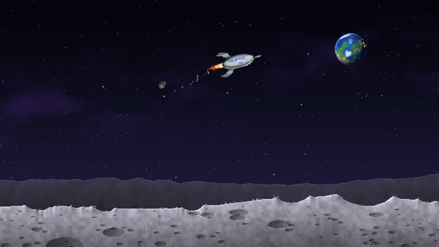

# Moon Lander

A pixel-art moon lander in two flavours built from one engine:

- **Animated wallpaper** for [Lively Wallpaper](https://www.rocksdanister.com/lively/) on Windows. It loops seamlessly while you work, and turns into a game the moment you grab the controls.
- **Browser game** you can host anywhere. This repo is set up to deploy to Cloudflare.



## Play

| Control | |
|---|---|
| ↑ / W | Main engine |
| ← → / A D | Side thrusters (spin keeps going until you counter-steer) |
| ↓ / S | Stop spinning |
| Space | Fire (the weapon overheats if you hold it) |
| Q | Switch weapon |
| Tab / G | Hangar: upgrades, weapons, ships, worlds (← → switch tabs) |
| H | Autopilot on/off |
| Esc / P | Pause (browser game) |
| Mouse | Drag & throw the rocket; click asteroids, UFOs, Sputniks, shooting stars |

Land gently on both legs for credits. Hit the ground too hard or too tilted and you'll explode or tip over. Spend credits in the hangar on upgrades (engine, gyro, landing legs, laser, shield, star magnet, rainbow exhaust), weapons (laser, scatter gun, railgun, homing missiles) and ships (Classic, Dart, Hauler, Gunship), and unlock the rest of the solar system: Mercury, Venus, Earth, Mars, Io, Titan, Miranda, Triton and Pluto each have their own gravity, colours and sky (the Sun, Jupiter, Saturn, Uranus, Neptune...). Every weapon builds heat as it fires and locks when it overheats. Watch out for UFOs and Sputnik squadrons. There are a few secrets too.

## Get it

- **Wallpaper:** download `moon-lander-wallpaper.zip` from Releases (or run `npm run build:wallpaper`), then drag it into Lively. To fly with the keyboard, enable *Lively → Settings → Wallpaper → Interaction → Wallpaper Input → Keyboard*.
- **Browser game:** see [docs/DEPLOY.md](docs/DEPLOY.md) for Cloudflare.

## Develop

```bash
npm install                      # only needed for tests / wrangler
npx playwright install chromium  # once, for tests
npm run validate                 # static checks
npm run build                    # dist/web, dist/wallpaper, dist/moon-lander-wallpaper.zip
npm run serve                    # http://localhost:8080
npm test                         # build + headless smoke test
```

No runtime dependencies or bundler. The game is one plain-JavaScript engine (`src/engine.js`) with a thin shell per target. Start with [CLAUDE.md](CLAUDE.md) and [docs/ARCHITECTURE.md](docs/ARCHITECTURE.md).

## Layout

```
src/        shared engine + embedded sprite
wallpaper/  Lively package files (settings schema lives here)
web/        browser game shell (title, pause, settings, touch controls)
scripts/    build, validate, zip, serve
tests/      Playwright smoke test
docs/       architecture, Lively notes, deployment, testing
```
